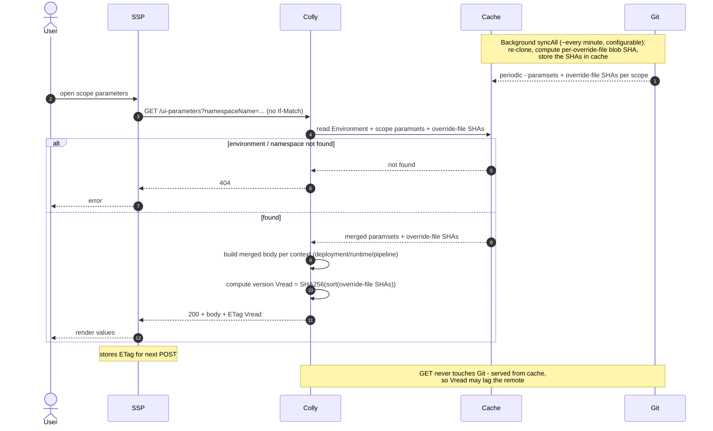
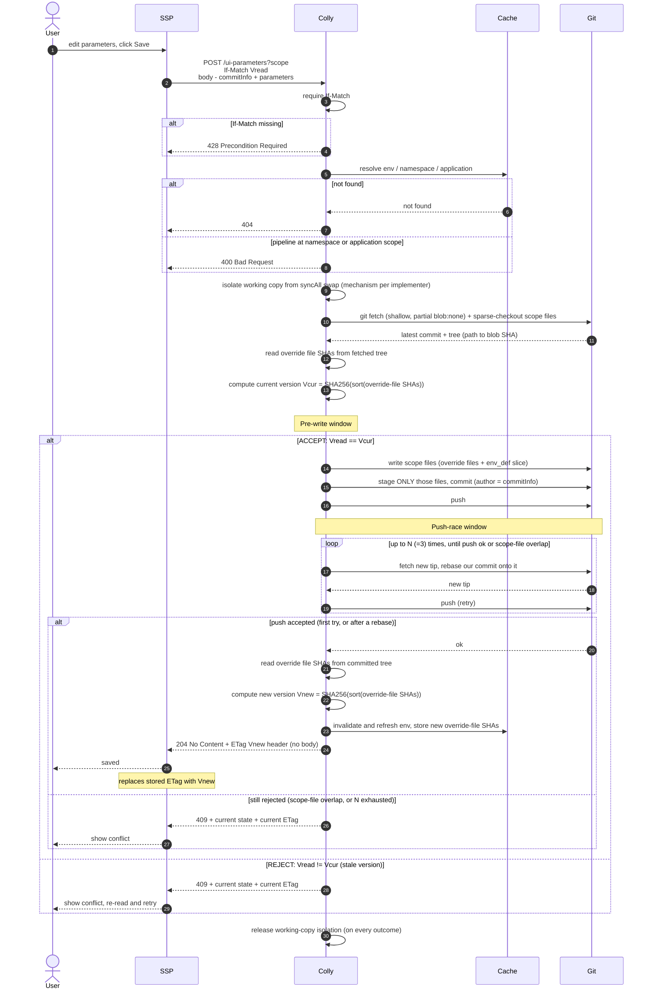

# Versioning and conflict handling for UI override parameters

- [Versioning and conflict handling for UI override parameters](#versioning-and-conflict-handling-for-ui-override-parameters)
    - [Introduction](#introduction)
    - [Requirements and constraints](#requirements-and-constraints)
        - [In scope](#in-scope)
        - [Out of scope](#out-of-scope)
    - [Decisions](#decisions)
    - [Versioning model](#versioning-model)
        - [What the version represents](#what-the-version-represents)
        - [ETag and If-Match](#etag-and-if-match)
    - [Request flows](#request-flows)
        - [GET](#get)
        - [POST](#post)
    - [Conflict handling](#conflict-handling)
    - [Deletion semantics](#deletion-semantics)
    - [API reference](#api-reference)
    - [Enabling changes](#enabling-changes)

## Introduction

This document specifies how Colly versions UI override parameters and how it detects and resolves
concurrent modifications to them. It extends the [Override UI API design](./ui-override.md): request
and response body shapes, scope selection, and storage layout are defined there. This document adds the
version token (HTTP `ETag`), the precondition header (`If-Match`), the conflict status codes, and the
server-side processing that ties them to Git.

## Requirements and constraints

### In scope

Three classes of collision must be handled correctly:

- **UI vs UI** - two users editing the same object through the same Colly instance.
- **UI vs direct Git push** - a UI user versus an administrator or CI pushing directly to the same
  instance repository.
- **Write vs `syncAll`** - a POST in flight versus the scheduled sync, which periodically re-clones the
  instance repository and swaps the working copy the write path operates on. Internal, but it can
  corrupt or lose an in-flight write, so it is a correctness requirement (see
  [Enabling changes](#enabling-changes)).

### Out of scope

- **Multiple Colly replicas.** Colly runs single-replica today. Horizontal scaling is not a target.
- **DELETE endpoint.** Follows the deferral in [ui-override.md](./ui-override.md).

## Decisions

A one-line index. Each decision is detailed in the linked section.

- **Versioning unit = (environment × scope)**, scope ∈ {`environment`, `namespace`, `application`}. One
  ETag per scope, not per context: `If-Match` versions the request-target URI (the scope), and one POST
  writes all the scope's contexts in one atomic commit. A per-context token would break both.
- **Version = override files only**, hashed by Git blob SHA. See
  [What the version represents](#what-the-version-represents).
- **`If-Match` is mandatory** (missing → `428`).
- **Atomic POST.** Any conflict rejects the whole request. The client re-reads and retries.
- **Single Strict resolution, single `409`** (no three-way merge, no `412`). See
  [Conflict handling](#conflict-handling).
- **Success = `204 No Content` + `ETag` header, no body.** See [API reference](#api-reference).
- **Push-race rebase retry `N = 3`**, then `409`. See [Conflict handling](#conflict-handling).
- **ETag = `"<scheme>:" + hex(SHA-256({path → blob-SHA}))`** See [ETag and If-Match](#etag-and-if-match).
- **Per-write Git copy = partial clone + sparse-checkout.** See [Enabling changes](#enabling-changes).
- **Not yet closed.** The tombstone deletion is blocked on verifying EnvGene's delete sentinel (see
  [Deletion semantics](#deletion-semantics)). The `syncAll` isolation mechanism and an optional rebase
  backoff are left to the implementer (see [Enabling changes](#enabling-changes)). Multi-replica is out
  of scope.

## Versioning model

### What the version represents

The version token (ETag) is a content version of the scope's **override files only** - a deterministic
hash over each override file's Git blob SHA, not the repo HEAD, not the cache generation, and not the
full merged representation the GET returns.

```text
version = SHA256( sort( { "<override-file-path>": "<git blob SHA>" } ) )
```

**The criterion is what the POST overwrites wholesale.** Optimistic concurrency prevents *lost
updates*, and an update can only be lost to data the request rewrites in full:

- **Override files** are serialized whole from the request body (`writeParamsetFile`), so a concurrent
  change would be clobbered - versioned.
- **The `env_definition.yml` slice** is edited *surgically* (`yq` moves only this scope's own entry, on
  the freshly fetched file), so other writers' edits survive - not versioned. Using the whole-file SHA
  would also cause false conflicts between unrelated scopes that share this one file.
- **Other referenced paramsets** are not written on add/modify - not versioned.

ETag is a **write-lock token, not an HTTP representation validator**: it is used only for `If-Match` on
POST, never for GET caching. GET merges *all* referenced paramsets (`CollyStorage.getUiParameters`), so
a change to the slice or another paramset can move the GET body without moving the ETag. That is
intentional - those are not overwritten by the user's write, and any residual Git-level race on them is
caught by the [push-race window](#conflict-handling). Anchoring to content, not repo HEAD, also means an
unrelated push never invalidates a pending edit.

**Computation.** The cache stores the per-file blob SHAs. The digest is computed on demand - on GET from
the cached SHAs, on POST from the fetched tree (`Vcur`) and the committed tree (`Vnew`). Identical
content yields an identical ETag across a cache rebuild.

### ETag and If-Match

Colly uses HTTP conditional requests:

- GET returns the scope version in the [`ETag`](https://www.rfc-editor.org/info/rfc9110/#section-8.8.3)
  response header.
- POST sends the last-read version in the [`If-Match`](https://www.rfc-editor.org/info/rfc9110/#name-if-match)
  request header. On mismatch, Colly rejects with `409`.
- A successful POST returns `204 No Content` with the new version in the `ETag` header.

GET is served from the cache, so its ETag reflects the data as returned and may lag the remote. POST
reconciles with the remote through a `fetch`.

The ETag is that version rendered for the header: a quoted string `"<scheme>:" + hex(SHA-256(canonical))`,
e.g. `"1:e3b0c442…"`, where *canonical* = the scope's override files as `(path, blob-SHA)` pairs, sorted
by path and joined with fixed separators (so `SHA-256(canonical)` is the `version` above). The `scheme`
prefix lets the hash change later - an old-scheme tag mismatches → `409`, and the client re-reads.
`If-Match: *` and multi-tag lists are rejected with `400`.

## Request flows

### GET



### POST



## Conflict handling

Between a client's GET and a fully-pushed POST, the state can diverge at two moments. Both return
`409`, and the client re-reads and retries either way. The response does not say which window fired,
because it would not change the client's reaction. Colly logs the window for its own metrics.

| Window        | When                                                         |
|---------------|--------------------------------------------------------------|
| **Pre-write** | before writing: `If-Match` vs current scope version          |
| **Push-race** | between Colly's `fetch` and its `push`, someone pushed first |

The pre-write check needs a `fetch` at POST time. Without it, it compares against a stale local clone
and cannot see direct pushes. A single code is used, not a separate `412`: at push-race time the
`If-Match` precondition actually *passed*, so `412 Precondition Failed` is inaccurate there, while `409`
("conflict with current state, resubmit") fits both.

Resolution is **Strict** - there is no parameter-level three-way merge, because the override file is
written wholesale:

- **Pre-write** (`Vread != Vcur`): the scope's override file changed since the read → `409`. The client
  reloads, re-applies its edits, resubmits.
- **Push-race** (first push non-fast-forward): `fetch` the new tip, **rebase** the commit onto it, retry
  up to `N = 3`. If the intervening commits did not touch this scope's files, the rebase is clean and
  the push succeeds - this is what keeps *unrelated* pushes from surfacing as conflicts. A real overlap
  or `N` exhausted → `409`. `N = 3` is ample: the push-race only collides with external direct pushes (a
  single replica serialises its own UI writes), which are rare and hit a sub-second window.

Two rules cover every case:

1. **The scope's override file changed under you → `409`** (re-read, retry). This is every UI-vs-UI edit
   to the same scope and every direct push that touched the scope's override file, including a stale
   session (the GET came from a cache older than the remote, but the POST `fetch` still catches it).
2. **Only unrelated files changed → the rebase absorbs it → `204`** (transparent). A genuine overlap
   during the push falls back to `409`.

On success, Colly invalidates the environment's cache so the next GET is fresh.

A `409` response carries the scope's current state and its current `ETag`, so the client resolves
without a separate GET. The three-way merge was dropped because it would need the `base` (override content at the
`If-Match` version), which the shallow/partial clone does not hold, only to save a re-read on the rare
same-file-different-key race.

## API reference

This design adds only the versioning concerns to the endpoints in
[ui-override.md](./ui-override.md#api-reference). GET returns an `ETag`. POST requires `If-Match` and
returns `204` + the new `ETag` on success, or a conflict code. The full flow is in
[Request flows](#request-flows).

```http
GET  /api/v2/environments/{id}/ui-parameters?namespaceName=env-01-core
→ 200, ETag: "1:e3b0c44298fc1c14…"

POST /api/v2/environments/{id}/ui-parameters?namespaceName=env-01-core
If-Match: "1:e3b0c44298fc1c14…"
→ 204, ETag: "1:<new>"   (or 409 + current state + current ETag)
```

| Status                      | When                                                               |
|-----------------------------|--------------------------------------------------------------------|
| `204 No Content`            | Success. New version in the `ETag` header, no body                 |
| `400 Bad Request`           | Missing field, `pipeline` at ns/app scope, or malformed `If-Match` |
| `404 Not Found`             | Environment, Namespace, or Application not found                   |
| `409 Conflict`              | Version conflict (pre-write or push-race)                          |
| `428 Precondition Required` | `If-Match` absent                                                  |

Success is `204` (not `200`/`201`): the current `setUiParameters` endpoint is a `void` method with no
body, and this design keeps that, adding only the `ETag` header. The create-vs-update distinction is not
exposed.

## Enabling changes

The fetch-before-write + scope-version approach requires these changes to the current write path:

1. **Stage only the scope's files**, not `git add .`, or the scope version stops being honest.
2. **Isolate the write working copy from `syncAll`**, which deletes and swaps the shared folder. The
   mechanism (dedicated checkout vs lock) is the implementer's choice. The requirement is only that an
   in-flight write cannot be corrupted.
3. **Partial clone (`--filter=blob:none`) + sparse-checkout** limited to the scope's files, so `fetch`
   pulls only the needed blobs and the working tree stays minimal.
4. **`fetch` + `rebase`/replay in `GitService`** (it exposes only clone / commit / push today).
5. **Cache invalidation on successful POST** for the affected environment.
