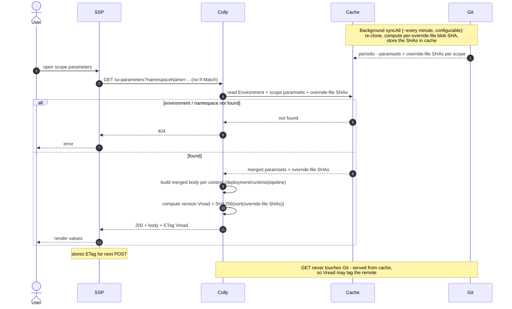
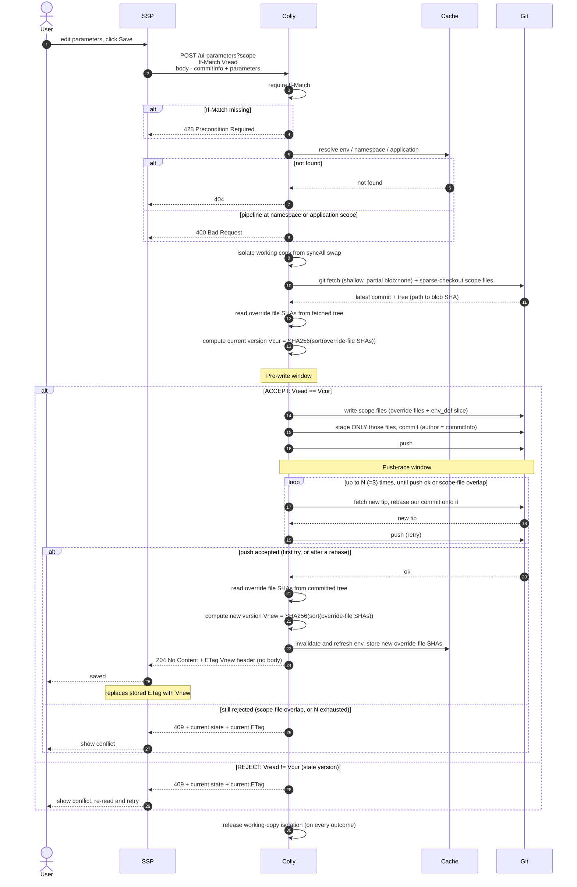

# Versioning and conflict handling for UI override parameters

- [Versioning and conflict handling for UI override parameters](#versioning-and-conflict-handling-for-ui-override-parameters)
  - [Introduction](#introduction)
  - [Handled collisions](#handled-collisions)
  - [Versioning model](#versioning-model)
      - [Version](#version)
    - [ETag and If-Match](#etag-and-if-match)
  - [Request flows](#request-flows)
    - [GET](#get)
    - [POST](#post)
  - [Conflict handling](#conflict-handling)
  - [API reference](#api-reference)
  - [Enabling changes](#enabling-changes)

## Introduction

This document specifies how Colly versions UI override parameters and detects concurrent modifications.
It extends the [Override UI API design](./ui-override.md), which defines body shapes, scope selection
and storage layout.

## Handled collisions

- **UI vs UI** - two users editing the same scope through Colly.
- **UI vs direct Git push** - a UI user versus an administrator or CI pushing to the instance repository.
- **Write vs `syncAll`** - a POST in flight versus the scheduled re-clone of the instance repository.

## Versioning model

### Version

- **Versioning unit** = (environment × scope), scope ∈ {`environment`, `namespace`, `application`}.
  One version per scope, covering all its contexts (`deployment`, `runtime`, `pipeline`).
- **Version input** = the scope's `-ui-override` files only:

  ```text
  version = SHA256( sort( { "<override-file-path>": "<git blob SHA>" } ) )
  ```

- **Not included:** repo HEAD, cache generation, `env_definition.yml`, other referenced paramsets.
  A change to them does not change the version.
- **Computation:** the cache stores per-file blob SHAs (filled by `syncAll`).
    - GET: from the cached SHAs → `Vread`.
    - POST: from the fetched tree → `Vcur`; from the committed tree → `Vnew`.
- Identical content always yields an identical version.

### ETag and If-Match

- **Format:** quoted string `"<scheme>:" + hex(SHA-256(canonical))`, e.g. `"1:e3b0c442…"`. *canonical* = the scope's
  override files as `(path, blob-SHA)` pairs, sorted by path, joined with fixed
  separators. Current `scheme` = `1`. A tag with another scheme does not match → `409`.
- **GET** returns the version in the `ETag` response header. GET is served from cache, the ETag may lag
  the remote.
- **POST** must send the last-read version in the `If-Match` request header.
    - absent → `428`
    - `*` or a multi-tag list → `400`
    - mismatch with the current version → `409`
- **Successful POST** returns `204 No Content` with the new version in the `ETag` header.
- ETag is used only for `If-Match` on POST, not for GET caching.

## Request flows

### GET



### POST



## Conflict handling

POST is atomic: any conflict rejects the whole request. Conflicts are detected in two windows, both
return `409`:

| Window        | Check                                                          | Result                                                   |
|---------------|----------------------------------------------------------------|----------------------------------------------------------|
| **Pre-write** | after `fetch`, before writing: `Vread` vs `Vcur`               | `Vread != Vcur` → `409`                                  |
| **Push-race** | push rejected as non-fast-forward (someone pushed after fetch) | `fetch` new tip, rebase, retry push, up to `N = 3` times |

Push-race outcome:

- intervening commits did not touch the scope's files → rebase is clean → push succeeds → `204`;
- rebase conflicts on the scope's files, or `N` retries exhausted → `409`.

Resolution is strict: no parameter-level merge.

- `409` body = the scope's current state, `ETag` header = its current version. The client re-applies its
  edits and resubmits with the new ETag.
- On `204`, Colly invalidates the environment's cache.
- The window that fired is logged, not returned to the client.

## API reference

Adds versioning to the endpoints in [ui-override.md](./ui-override.md#api-reference).

```http
GET  /api/v2/environments/{id}/ui-parameters?namespaceName=env-01-core
→ 200, ETag: "1:e3b0c44298fc1c14…"

POST /api/v2/environments/{id}/ui-parameters?namespaceName=env-01-core
If-Match: "1:e3b0c44298fc1c14…"
→ 204, ETag: "1:<new>"   (or 409 + current state + current ETag)
```

| Status                      | When                                                               |
|-----------------------------|--------------------------------------------------------------------|
| `204 No Content`            | Success. New version in the `ETag` header, no body                 |
| `400 Bad Request`           | Missing field, `pipeline` at ns/app scope, or malformed `If-Match` |
| `404 Not Found`             | Environment, Namespace, or Application not found                   |
| `409 Conflict`              | Version conflict (pre-write or push-race)                          |
| `428 Precondition Required` | `If-Match` absent                                                  |

## Enabling changes

Required changes to the current write path:

1. **Stage only the scope's files** instead of `git add .`.
2. **Isolate the write working copy from `syncAll`** (dedicated checkout or lock) so an in-flight write
   is not affected by the re-clone.
3. **Partial clone (`--filter=blob:none`) + sparse-checkout** limited to the scope's files.
4. **`fetch` + `rebase` in `GitService`** (today it exposes only clone / commit / push).
5. **Cache invalidation on successful POST** for the affected environment.
