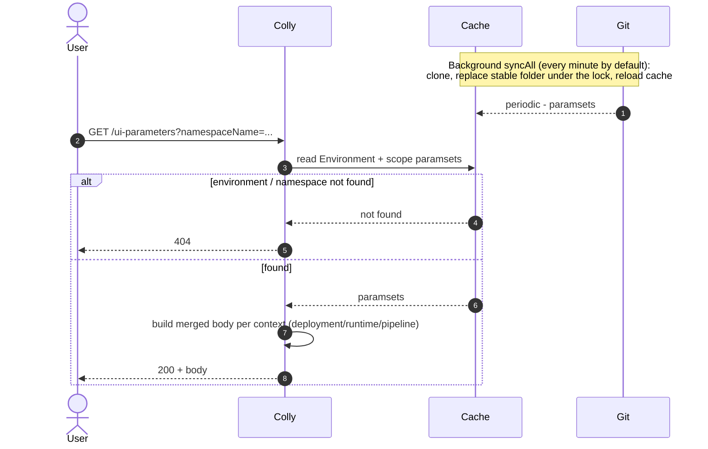
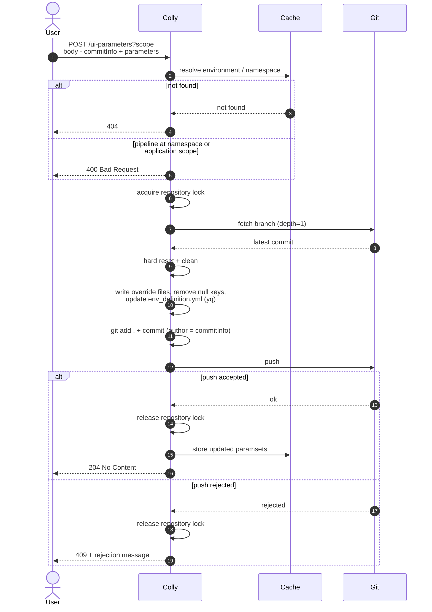

# Concurrent writes for UI override parameters

- [Concurrent writes for UI override parameters](#concurrent-writes-for-ui-override-parameters)
  - [Introduction](#introduction)
  - [Handled collisions](#handled-collisions)
  - [Not implemented](#not-implemented)
  - [Write serialization](#write-serialization)
      - [Repository lock](#repository-lock)
      - [Sync before write](#sync-before-write)
      - [Rejected push](#rejected-push)
  - [Request flows](#request-flows)
    - [GET](#get)
    - [POST](#post)
  - [Known limitations](#known-limitations)
  - [API reference](#api-reference)
      - [History URL](#history-url)

## Introduction

This document describes how Colly handles concurrent changes to UI override parameters as implemented
today. It extends the [Override UI API design](./ui-override.md), which defines body shapes, scope
selection and storage layout.

Colly has no parameter versioning. It serializes writes to the local Git working copy, applies each write
on top of the latest remote state, and relies on Git to reject a push that lost a race. History is the
Git history of the override file, and Colly exposes a link to it.

The same write path is used by `UpdateEnvironmentService.updateParamset` (UI parameters) and
`UpdateEnvironmentService.updateEnvironment` (environment metadata).

## Handled collisions

| Collision                                 | Handling                                                                                   |
|-------------------------------------------|--------------------------------------------------------------------------------------------|
| **Write vs write, same Colly instance**   | Serialized by the repository lock. The second write runs after the first one, on top of it |
| **Write vs `syncAll` folder replacement** | Serialized by the repository lock                                                          |
| **Write vs direct Git push**              | The write starts from the latest remote state, so commits already pushed are preserved     |
| **Push race**                             | Remote rejects the push as non-fast-forward → `409`                                        |

## Not implemented

The following parts of the original design were not implemented:

- scope versions and conditional request headers;
- detection of stale reads: Colly does not know which state the client read before sending a POST;
- rebase and push retry: a rejected push fails immediately;
- `409` response with the scope's current state;
- per-file blob SHAs in the cache;
- partial clone and sparse-checkout: clones are shallow (`depth=1`) and contain all files;
- staging only the scope's files: Colly still runs `git add .`. The working copy is reset and cleaned
  before each write, so a commit contains only the changes of that write.

## Write serialization

### Repository lock

`GitRepositoryLocks` keeps one `ReentrantLock` per local repository folder. The following operations run
under it:

- the whole write sequence: sync, modify files, commit and push;
- the `syncAll` step that replaces the stable folder with the fresh clone (`CloudPassportLoader.replaceStableFolder`).

The clone itself runs outside the lock, into a `-tmp` folder. Clone folder names are stable,
`<project name>-<first 12 hex chars of sha256(url)>`, so a cached `GitInfo.folderName` keeps pointing to
the same repository across syncs.

The lock is held during network calls to Git, so writes to the same repository wait for each other.
Writes to different repositories do not block each other.

### Sync before write

`GitService.syncWithRemote` runs under the lock before any file is modified:

1. Fetch the current branch from `origin` (`depth=1`).
2. Hard-reset the working copy to `origin/<branch>`.
3. Remove untracked files.

Local commits and changes are discarded. This also removes leftovers of a previous failed write, such as a
commit whose push was rejected.

### Rejected push

JGit reports a remote rejection in the push result instead of throwing an exception.
`GitService.verifyPushResults` treats any status other than `OK` or `UP_TO_DATE` as a rejection and throws
`GitPushRejectedException`, which `GitPushRejectedExceptionMapper` maps to `409`. This covers
non-fast-forward rejections and any other remote refusal, such as a protected branch.

The response body is the plain-text rejection message. The client retries by sending the POST again.

A failure other than a remote rejection, for example a network error during fetch or push, returns `500`.

## Request flows

### GET

`GET /ui-parameters` does not take the lock and does not touch Git. It is served from the cache filled by
`syncAll` (every minute by default, `colly.eis.cron.schedule`) and updated by successful POSTs.



### POST



## Known limitations

- **Lost update.** POST replaces the content of the scope's override file for each context present in the
  body. If two users edit the same scope, the later POST silently overwrites the earlier one, including
  when the request was built from an outdated read. This also applies to a direct Git push to the override
  file. The overwritten values remain in the Git history.
- **Null keys use the cached state.** The source files to remove a `null` key from are selected from the
  cache, not from the synced working copy. A key added to another paramset by a commit that `syncAll` has
  not loaded yet is not removed.
- **Single instance scope.** The lock is local to the JVM. Instances of the service do not share it, and each
  has its own clone. A race between instances is resolved only by the remote rejecting the push (`409`).
- **`syncAll` reads files outside the lock.** Only the folder replacement is locked. Parsing the stable folder
  can overlap with a write, so a sync may load uncommitted changes or changes of a write that then fails.
  A later sync corrects the cache.
- **Stale reads after a write.** A `syncAll` that cloned before a push can store the older state in the cache
  after the POST has returned. GET returns the older values until the next sync.
- **Other replicas.** On other instances, GET returns the new values only after their next `syncAll`.

## API reference

```http
GET  /colly/v2/inventory-service/environments/{id}/ui-parameters?namespaceName=env-01-core
→ 200

POST /colly/v2/inventory-service/environments/{id}/ui-parameters?namespaceName=env-01-core
→ 204 (or 409 + rejection message)
```

POST status codes:

| Status                      | When                                                                           |
|-----------------------------|--------------------------------------------------------------------------------|
| `204 No Content`            | Success, no body                                                               |
| `400 Bad Request`           | `pipeline` at namespace or application scope, or Inventory directory not found |
| `404 Not Found`             | Environment or namespace not found                                             |
| `409 Conflict`              | Push rejected by the remote                                                    |
| `500 Internal Server Error` | Sync, commit or push failed for a reason other than a remote rejection         |

`applicationName` is not validated: an unknown application does not return `404`.

### History URL

`GET /colly/v2/inventory-service/environments/{id}/ui-parameters-history-url` returns, as plain text, a
link to the commit history of the scope's `-ui-override` file in the instance repository.

| Query parameter   | Required | Description                                                                  |
|-------------------|----------|------------------------------------------------------------------------------|
| `context`         | yes      | `deployment`, `runtime` or `pipeline`                                        |
| `namespaceName`   | no       | Selects namespace scope. Not allowed with `pipeline`                         |
| `applicationName` | no       | With `namespaceName`, selects application scope. Not allowed with `pipeline` |

```text
<instance repository url>/commits/<branch or HEAD>/environments/<cluster>/<environment>/Inventory/parameters/<file>.yaml
```

The URL is built from the cached environment and does not check that the file exists.

| Status | When                                                                      |
|--------|---------------------------------------------------------------------------|
| `200`  | URL returned                                                              |
| `204`  | The cluster has no instance repository information                        |
| `400`  | Unknown `context`, or `pipeline` with `namespaceName` / `applicationName` |
| `404`  | Environment or namespace not found                                        |
